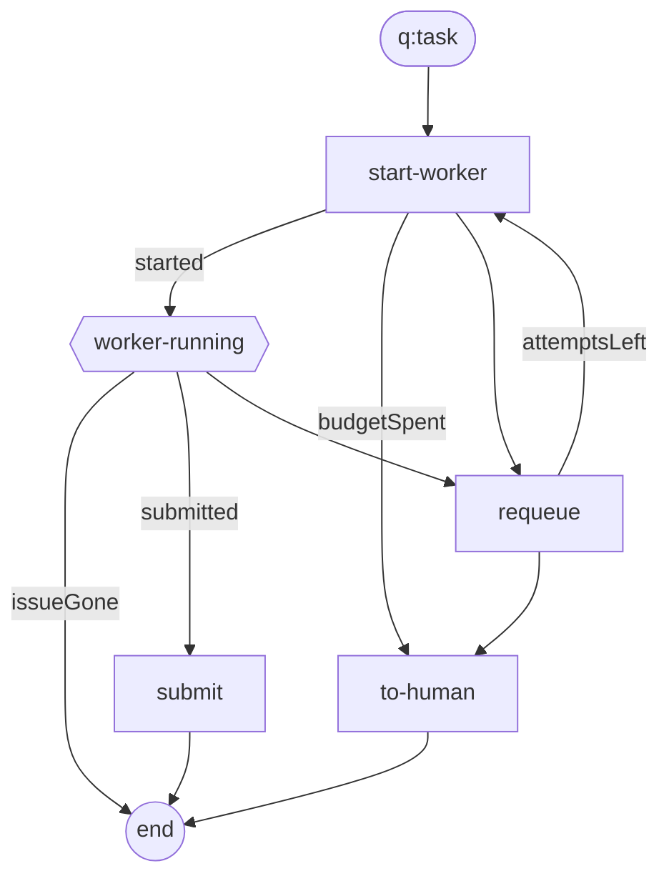
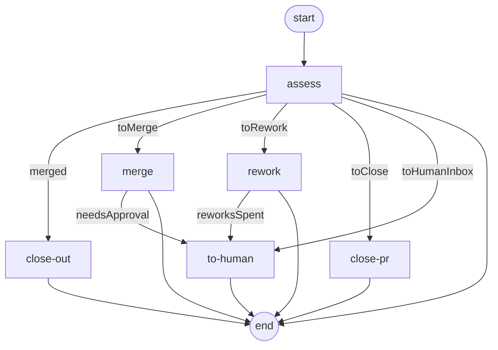
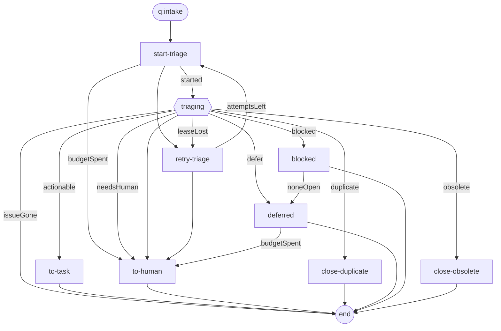
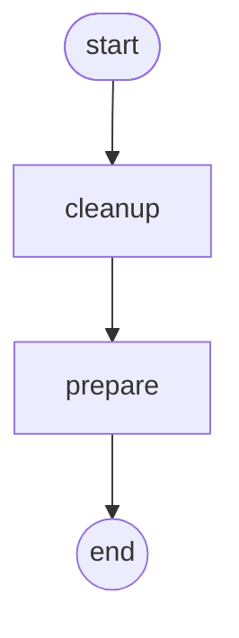
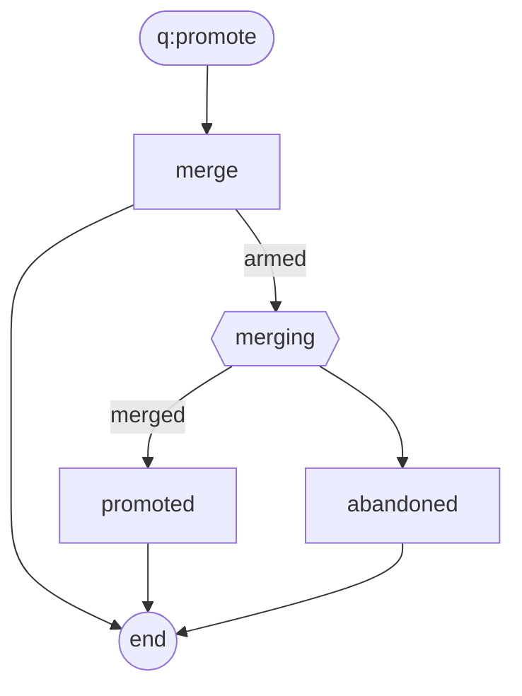
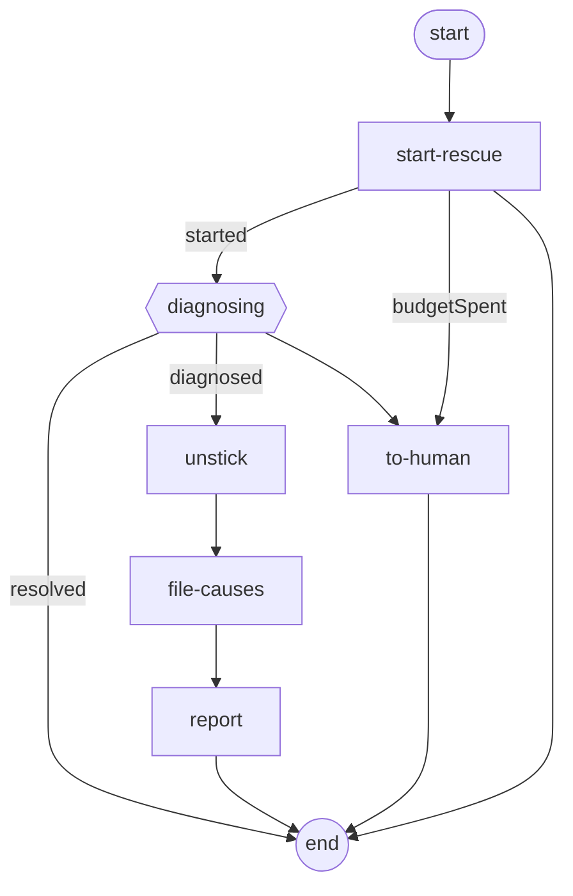

# cambium

The scheduler daemon. Every tick it reads the `q:*` queues from GitHub, starts headless `claude -p` workers in their own worktrees up to a cap, watches their PRs through CI and the merge queue, and makes every queue transition itself. GitHub is the truth; local SQLite only remembers which processes it started.

This is the **Task phase** MVP. With `engine: "graph"`, `q:intake` issues are triaged by the [`dispatch` graph](#the-dispatch-graph) and Release runs as graphs; on the legacy engine both are seams (see [Follow-ups](#follow-ups)).

Runtime dependencies: `zod` (the [graph module](#graph-module-preview)) and OpenTelemetry via `@oakgreencc/mycelium` (loaded only when [tracing](#tracing) is on); Node ≥ 22.13 (`node:sqlite`). GitHub access goes through [`graft`](../graft), which must be on `PATH`.

## Quick start

```sh
npm install -g @oakgreencc/cambium @oakgreencc/graft
mkdir -p ~/.cambium && $EDITOR ~/.cambium/config.json   # see Configuration
cambium start --once          # one tick in the foreground
cambium install               # writes ~/Library/LaunchAgents/com.oakgreencc.cambium.plist
launchctl bootstrap gui/$(id -u) ~/Library/LaunchAgents/com.oakgreencc.cambium.plist
cambium status
```

## Commands

| Command                                                                         | What                                                                                                                                                                                                                                                                                                                                                                                                                                                                                                                                                                                                                                                                                                                                                                                                                                                                                    |
| ------------------------------------------------------------------------------- | --------------------------------------------------------------------------------------------------------------------------------------------------------------------------------------------------------------------------------------------------------------------------------------------------------------------------------------------------------------------------------------------------------------------------------------------------------------------------------------------------------------------------------------------------------------------------------------------------------------------------------------------------------------------------------------------------------------------------------------------------------------------------------------------------------------------------------------------------------------------------------------- |
| `cambium start [--once]`                                                        | Foreground daemon, one tick every `tickSeconds`. SIGTERM/SIGINT stop it after the current tick; workers keep running and are re-adopted on restart. One daemon per database.                                                                                                                                                                                                                                                                                                                                                                                                                                                                                                                                                                                                                                                                                                            |
| `cambium status [--json]`                                                       | Mode, last tick, queue counts, workers, failed steps. Exit 1 when there is no heartbeat or it is older than 3 ticks.                                                                                                                                                                                                                                                                                                                                                                                                                                                                                                                                                                                                                                                                                                                                                                    |
| `cambium pause`                                                                 | Read and heartbeat only: no transitions, no starts. Running workers are left alone.                                                                                                                                                                                                                                                                                                                                                                                                                                                                                                                                                                                                                                                                                                                                                                                                     |
| `cambium drain`                                                                 | Reconcile, watch and sweep as usual; start nothing new.                                                                                                                                                                                                                                                                                                                                                                                                                                                                                                                                                                                                                                                                                                                                                                                                                                 |
| `cambium resume`                                                                | Back to `running`.                                                                                                                                                                                                                                                                                                                                                                                                                                                                                                                                                                                                                                                                                                                                                                                                                                                                      |
| `cambium run task --issue <n> [--repo <owner/name>]`                            | Claim one open `q:task` issue, run its worker in the foreground, then make the same transition the daemon would.                                                                                                                                                                                                                                                                                                                                                                                                                                                                                                                                                                                                                                                                                                                                                                        |
| `cambium run <task\|pr\|dispatch> --issue <n> [--repo <owner/name>] [--follow]` | `engine: "graph"` only. `task`: advance one issue through the graph runtime in the foreground: a `q:task` issue without a lease starts with a foreground worker; anything else resumes where its marker rests. `pr`: the [PR graph](#the-pr-graph) for the issue's PR. `dispatch`: triage one `q:intake` issue with a foreground triage worker (the dispatch cap does not apply), read its verdict and end the [dispatch graph](#the-dispatch-graph); a tracked triage worker resumes at `triaging`. Stops at the first wait that is not ready; `--follow` re-reads and polls every `tickSeconds` until the graph ends. Beside a live daemon (fresh heartbeat) `--follow` reads the daemon's [snapshots file](#snapshots-snapshotsjson) instead of GitHub, waiting for a snapshot read after its last turn; with no daemon, a stale heartbeat or no usable file it reads GitHub itself. |
| `cambium run release-prepare [--repo <owner/name>]`                             | `engine: "graph"` only. Run [release-prepare](#the-release-graphs) now, whatever `release.time`: close stale promotion PRs, cut `release/<date>-N` at the newest green commit on `release.from` and open its PR. Counts as the day's run.                                                                                                                                                                                                                                                                                                                                                                                                                                                                                                                                                                                                                                               |
| `cambium run release-promote [--repo <owner/name>] [--issue <pr>]`              | `engine: "graph"` only. A [release-promote](#the-release-graphs) turn for each `q:promote` promotion PR (or only `<pr>`): merge an approved one, close out a merged or closed one; report the rest as not ready.                                                                                                                                                                                                                                                                                                                                                                                                                                                                                                                                                                                                                                                                        |
| `cambium run rescue [--repo <owner/name>] [--issue <n>]`                        | `engine: "graph"` only. Without `--issue`: list the items the [rescue](#the-rescue-graph) sweep would find stuck now, with their symptoms (the cooldown aside); changes nothing. With it: rescue that item now with a foreground rescue worker, then carry out its verdict.                                                                                                                                                                                                                                                                                                                                                                                                                                                                                                                                                                                                             |
| `cambium gc [--dry-run] [--repo <owner/name>]`                                  | Collect worktrees now; `--dry-run` only reports. See [Worktree GC](#worktree-gc).                                                                                                                                                                                                                                                                                                                                                                                                                                                                                                                                                                                                                                                                                                                                                                                                       |
| `cambium install [--dry-run]`                                                   | Write the launchd agent (`KeepAlive`, `RunAtLoad`) for `start --config <this config>`; `--dry-run` prints it. It does not call `launchctl`; it prints the command.                                                                                                                                                                                                                                                                                                                                                                                                                                                                                                                                                                                                                                                                                                                      |
| `cambium update [--check] [--version <v>]`                                      | Install the latest version (or `<v>`, even an older one) from npm into this global install, then SIGTERM the launchd agent so it finishes its tick and KeepAlive starts the new version. `--check` only reports. No config file needed. See [Self-update](#self-update).                                                                                                                                                                                                                                                                                                                                                                                                                                                                                                                                                                                                                |

Every command takes `--config <file>`; the default is `$CAMBIUM_CONFIG`, then `~/.cambium/config.json`.

## One tick

Each step is bounded by `stepTimeoutSeconds`. A step that throws or times out is logged and recorded in the heartbeat, and the tick moves on. Nothing waits on a worker.

1. **Read.** One GraphQL query per repo (`graft graphql`): open issues with any `q:` label (100 per page; more pages follow the cursor, so a busy queue's newest issues are not invisible), open and recently merged PRs on `agent/*` with their check rollup, merge-queue state, `mergeable`, `reviewDecision` and the issues they close. Each issue's newest 20 comments come with their time and author type, for [human replies](#the-dispatch-graph). GitHub links closing references only for a PR into the default branch, so cambium also reads `Closes/Fixes/Resolves #n` from the PR body, fetching issues the first query did not read in one more (also the issue an open PR that closes none names by its branch, `agent/<n>-…`, for the [reaper](#upkeep)). A worker's PR that names no issue (found by its branch) gets `Closes #n` added at submission. With `intake.adopt` (the default), the same query also searches for the oldest 20 open issues with no `q:` label and no `running` lease (minus `intake.ignoreLabels`), for Adopt.
2. **Reconcile.** For each tracked worker: alive and under its wall-clock cap → nothing. Over the cap → terminate it: every process below `claude` (its Bash tools, a test run) is SIGKILLed at once, and `claude` gets SIGTERM, on which Claude Code ends its interaction span and flushes its exporter (a bare SIGKILL left `claude_code.*` spans orphaned under a root that was never exported). It usually exits within a second; still alive 30 s past the cap (and at least one tick later) → kill its process group and every descendant (Claude Code runs each Bash command in a group of its own, so a group kill alone left a test run loading the next attempt). Gone → exit check (a PR on its branch, or closing its issue, that is open or merged and not still on the commit CI already failed) → `submitted`; otherwise requeue with the stderr tail (a failed prepare step requeues as `spawn-failed`). Then the worktree is torn down if `graft status` says GitHub holds everything in it and no process has its cwd inside it (`lsof`; the worktree's own nx daemon excepted), else kept with a `warn` saying why. Teardown stops the worktree's nx daemon (nx keys each daemon to its workspace root, so no other checkout's is touched; left running, it served the next client from a deleted tree until `nx reset`), moves the tree to `<paths.home>/trash` with one rename, prunes git's record, and erases the trash in the background: a worktree with CocoaPods in it took `git worktree remove` past the step timeout. A worker's row is removed only after GitHub took its transition's writes; a write refused (a missing label, a permission) keeps the row, counts the failure on it, and skips it until a retry 1 minute later, doubling to at most 1 hour, so a write that keeps failing is not redone every tick. Its `claude.*` spans are emitted once, on the first poll that reads its log.
3. **Watch** (no agent). Graph engine: the [PR graph](#the-pr-graph), once per tick for each agent PR whose CI has settled and whose issue has no Task queued or running: merge, rework, close, or `q:human`. Legacy, for agent PRs whose issue is in no queue: merged → close the issue, delete the branch; red → requeue with the failing checks' summaries; left the merge queue without merging → requeue; not merged `mergeQueueMinutes` after submission → `q:human`.
4. **Sweep.** An issue labelled `running` with this host (or no host) in its marker and no tracked worker → requeue. This is what makes losing the SQLite file cost one requeue.
5. **Adopt** (`src/adopt.mjs`; both engines, not while paused). An open issue in no queue with no state comment, named by no agent PR (its `closes`, or its branch), and not labelled `watch`, `red-base`, `rescue`, `stall` or one of `intake.ignoreLabels` gains `q:intake`: an issue filed without the label is triaged instead of ignored. It joins the snapshot, so Schedule can triage it in the same tick. `intake.adopt: false` turns this off.
6. **Schedule.** Start Task workers for `q:task` issues without `running`, by priority label then age, up to `phases.task.cap` counted from live workers. A task requeued earlier in the same tick can start in that tick. Then, with `engine: "graph"` and `phases.dispatch.cap > 0`, first wake `q:human` and parked intake issues that have a human reply, then start triage workers for `q:intake` issues the same way ([the dispatch graph](#the-dispatch-graph)).
7. **Release.** Legacy: once a day at `release.time` when `release.enabled`; the run itself is a seam. Graph: the [release graphs](#the-release-graphs), per repo.
8. **Upkeep** (graph engine). The hourly [reaper](#upkeep) of untracked agent PRs, then the [stall fallback](#upkeep) for a queue that stopped moving.
9. **Heartbeat.** Write the state file.

A requeue is `q:task` with attempt + 1, or, once `maxAttempts` are spent, `q:human` + `why:budget`. Who merges a Task PR is the repo's `merge` setting ([The PR graph](#the-pr-graph)): by default not cambium (a merge queue, auto-merge or a human); with `"merge": "green"` cambium merges it once CI is green. The other merge cambium asks for is an approved promotion PR, through `graft pr merge`; see [The release graphs](#the-release-graphs).

## State on GitHub

| Label                                               | Meaning                                                                                                                |
| --------------------------------------------------- | ---------------------------------------------------------------------------------------------------------------------- |
| `q:intake`, `q:task`, `q:human`, `q:promote`        | The queue. At most one per open issue.                                                                                 |
| `q:promote` on a closed issue                       | Merged into `release.from`, not yet in `release.to` ([Awaiting promotion](#awaiting-promotion)).                       |
| `running`                                           | A worker holds the lease (with `q:task`).                                                                              |
| `why:budget`, `why:triage` (also `why:reject`, …)   | Why it is in `q:human` (`why:triage`: sent there by triage, see below).                                                |
| `why:rescue`                                        | In `q:human` because the [rescue graph](#the-rescue-graph) could not unstick it.                                       |
| `ask:*`                                             | With `q:human`: what the person is asked (`ask:decide`, `ask:verify`, `ask:chore`, `ask:approve`; plus `ask:session`). |
| `rescue`                                            | A root-cause ticket the rescue graph filed.                                                                            |
| _no `q:` label_, cambium comment, open `agent/*` PR | Submitted: in the Release Queue, which is the PR's merge-queue state.                                                  |
| `priority:critical` … `priority:low`                | Scheduling order (configurable). Unlabelled sorts after every listed priority.                                         |

Only cambium moves these labels; workers have `graft issue label` and `graft issue edit` denied.

Each issue cambium touches gets one comment it owns and edits in place. Its first line is a hidden marker, the rest is a human rendering of it:

```html
<!-- cambium:state {"v":1,"phase":"task","stage":"queued","attempt":2,"pr":120,"branch":"agent/12-fix-the-tick","host":null,"start":null,"submittedAt":"…","queued":false,"failedSha":"deadbeef…","lastFailure":"CI red on PR #120 …","history":[{"at":"…","attempt":1,"outcome":"ci-red","reason":"…","pr":120}]} -->
```

- `stage`: `queued` | `running` | `submitted` | `human` | `done`.
- `attempt`: the attempt the next (or current) worker runs as, from 1.
- `host`, `start`: set while `running`.
- `failedSha`: the PR head CI was red on; the same commit is never requeued twice, and a worker that exits without moving the head past it has failed.
- `history`: the last 20 outcomes: `submitted`, `failed`, `killed`, `lost`, `spawn-failed`, `ci-red`, `dequeued`, `stalled`, `merged`, `budget`. `log` names the worker's stdout log on the host.
- `--` inside the JSON is written as `--` so the comment cannot end early.

Set `graft.botLogin` to the Clock App's login and only markers written by it are trusted.

**Cost.** When a task, triage or rescue worker exits, cambium reads the `result` event at the end of its stream-json log (`total_cost_usd`, `usage`) and adds it to the marker's `cost`: `{ total, triage, task, rescue, lastLog }`, each phase a tally `{ usd, input, output, cacheRead, cacheCreation, runs }` (`src/cost.mjs`). It lives on GitHub, so it survives a restart, and every marker write keeps it. `lastLog` is the last run counted, so a re-checked exit is never counted twice. A worker with no `result` (killed, truncated log) adds nothing; a marker from before `cost` counts from zero. Each run also goes into a per-repo, per-UTC-day ledger in SQLite (`costs` table) for the heartbeat's daily figures; losing the database loses only that history. The rendered comment shows `cost $<total>`.

## Workers

A worker is `claude -p --output-format stream-json --verbose --thinking-display summarized --max-turns <maxTurns> --allowedTools Read,Edit,Write,Glob,Grep,Bash --disallowedTools "Bash(graft issue label:*),Bash(graft issue edit:*),Bash(gh:*)" <worker.args>`:

- in its own worktree, by the target repo's [worktree convention](#target-repo-convention);
- behind the prepare step: `node src/prepare.mjs -- claude …` runs install-fresh, hydrate and the repo's `prepare` commands in the worktree, writing to the worker's stderr log, then becomes the worker. It runs in the detached process so a long install never blocks a tick;
- detached, leading its own process group (a kill takes the group and, by a `ps` snapshot, every descendant), stdin from the prompt file;
- with `CAMBIUM_REPO`, `CAMBIUM_ISSUE`, `CAMBIUM_PHASE`, `CAMBIUM_BRANCH` set, `GRAFT_APP=<worker.graftApp>` when configured, then `worker.env`, then `TRACEPARENT` (the starting node's span) when [tracing](#tracing) is on;
- with its prompt, stdout and stderr at `<paths.logs>/<owner>__<name>/issue-<n>/a<attempt>-<stamp>.{prompt.md,out.log,err.log}`, keeping the newest `logs.keepPerIssue` runs per issue.

The prompt states the four-point contract (task issue, `pnpm verify`, `graft publish <branch> … --closes <n>`, `graft ci wait`), the attempt, the existing PR if any (`graft advance` onto it), the last failure, the issue's history, the issue body, and the worktree's `AGENTS.md`.

## Session briefs

A `q:human` item worth an interactive session gets a brief at `<paths.home>/briefs/<owner>__<name>/issue-<n>.md` (src/briefs.mjs). One function, `isSessionCandidate`, decides who: today an open issue with `q:human` and `why:budget`. Every tick (paused too; nothing goes to GitHub) cambium renders each candidate's brief from the snapshot and rewrites the file when the text changed, so it follows the issue into `q:human` and every marker change; any other `issue-<n>.md` in a read repo's directory is deleted (the issue left `q:human`, or closed). A repo whose read failed is left alone.

A brief holds the title, link, body (first 4,000 characters) and acceptance checks (triage's, else the body's checkboxes); graph, node, attempts, reworks, `failedSha`, `lastFailure` and the marker history; the issue's agent PRs, plus any the history names; the reasons in the history, as approaches already rejected; the question, options and recommendation when the marker has an `ask`; and the repo path with the verify and publish contract. Token-shaped text (provider tokens, bearer auth, URL credentials, the value of any `*TOKEN*`/`*SECRET*`/`*PASSWORD*`/`*KEY*` assignment) becomes `[redacted]`. Files are written `0600`. canopy shows `cd <repo> && claude "$(cat <brief>)"` for each item with a brief.

## Configuration

One JSON file. Everything but `repos` is optional; these are the defaults:

```json
{
  "host": "<os.hostname()>",
  "engine": "legacy",
  "tickSeconds": 30,
  "stepTimeoutSeconds": 20,
  "repos": [{ "slug": "oakgreencc/monorepo", "path": "~/OGCC/monorepo", "baseBranch": "main" }],
  "phases": {
    "task": { "cap": 2, "wallClockMinutes": 60, "maxTurns": 200, "maxAttempts": 3, "maxReworks": 3 },
    "dispatch": {
      "cap": 0,
      "wallClockMinutes": 15,
      "maxTurns": 50,
      "maxAttempts": 3,
      "maxRounds": 3,
      "deferHours": 6,
      "maxDefers": 8
    },
    "rescue": { "cap": 0, "wallClockMinutes": 20, "maxTurns": 80, "maxAttempts": 1 }
  },
  "mergeQueueMinutes": 120,
  "mergeStallMinutes": 20,
  "watchEveryMinutes": 5,
  "merge": "none",
  "priorityLabels": ["priority:critical", "priority:high", "priority:medium", "priority:low"],
  "release": { "enabled": false, "time": "06:00", "readEveryMinutes": 5 },
  "reaper": { "everyMinutes": 60, "staleMinutes": 30, "orphanDays": 3 },
  "stall": { "everyMinutes": 15, "starvedHours": 6, "graceMinutes": 60, "overdueMinutes": 60 },
  "rescue": {
    "everyMinutes": 60,
    "staleHours": 12,
    "graceMinutes": 30,
    "cooldownHours": 24,
    "maxRescues": 2,
    "causeRepo": null
  },
  "paths": {
    "home": "~/.cambium",
    "db": "~/.cambium/cambium.db",
    "heartbeat": "~/.cambium/state.json",
    "queues": "~/.cambium/queues.json",
    "snapshots": "~/.cambium/snapshots.json",
    "logs": "~/.cambium/logs"
  },
  "logs": { "keepPerIssue": 20, "daemonMaxBytes": 10485760 },
  "graft": { "command": "graft", "app": null, "botLogin": null },
  "worker": { "command": "claude", "args": [], "graftApp": null, "fetch": true, "env": {} },
  "update": { "auto": false, "checkMinutes": 360 },
  "gc": { "everyMinutes": 60, "graceMinutes": 60, "staleDays": 14 },
  "costFlagUsd": 10
}
```

- `intake.adopt` (default `true`) and `intake.ignoreLabels` (default `[]`): see Adopt in [the tick](#one-tick).
- `costFlagUsd`: an open issue whose task-phase cost is over this many US dollars with no merged PR closing it is `flagged` in the heartbeat; canopy lists it in the Inbox as a session candidate. `0` turns the flag off.
- `worker.env` is extra environment for every worker (string values only), e.g. Claude Code's own telemetry ([Tracing](#claude-codes-own-spans-under-the-worker)).

- The daemon re-reads the file before every tick, so caps, limits, `tickSeconds`, `repos`, priority labels, `release` and `worker` take effect without a restart (logged as `config reloaded: <keys>`). `host`, `engine`, `paths`, `logs` and `graft` are baked in at start: a change to them logs `restart cambium to apply` once and is not applied. A file that does not load, or has no `repos`, keeps the running config and logs one warning until it is fixed.
- `repos[].path` is a local clone; worktrees are added from it and `graft` runs in it.
- `graft.app` is the App cambium acts as (`GRAFT_APP` for its own `graft` calls); `worker.graftApp` the one workers act as. Neither leaks into the other.
- `merge` (top level, or per repo in `repos[]`): who merges a Task PR. See [The PR graph](#the-pr-graph).
- `repos[].requiredCheck` (default `"ci"`): the check whose runs on `baseBranch` say whether the base is green; `null` turns the [red-base](#red-base) gate and repair off for that repo.
- `engine` picks how the Task phase runs: `"legacy"` (the stage tick, the default) or `"graph"` (the [`task` graph](#the-task-graph)). Both make the same moves; see [The task graph](#the-task-graph). Only `"graph"` runs the [`dispatch` graph](#the-dispatch-graph) (gated by `phases.dispatch.cap`); legacy leaves `q:intake` alone.
- `stall` (`engine: "graph"`): the [stall fallback](#upkeep). `retriage` (the daily re-triage of every `q:human` issue) is removed; the stall fallback replaces it, and an old file's `retriage` key is ignored.
- `phases.rescue.cap` (`engine: "graph"`; 0, the default, turns it off) and `rescue`: see [The rescue graph](#the-rescue-graph).
- Setting `paths.home` moves every default path under it.
- `release.time` is host-local `HH:MM`.
- `repos[].phases`: per-repo overrides of `wallClockMinutes` and `maxTurns`, by phase (`{ "task": { "wallClockMinutes": 120 } }`); other keys are refused. `capsFor` in `src/config.mjs` merges them over the global `phases`.
- `repos[].watch`: workflows whose newest completed push or schedule run on a branch must be green (`src/watch.mjs`). Each entry is a workflow file name, or `{ "workflow", "branch", "issue" }` (`branch` defaults to `baseBranch`, `issue` to `true`). Read every `watchEveryMinutes` (default 5; `0` off); cancelled and skipped runs are passed over. Red → a `warn` event and, with `issue`, one `q:human` issue labelled `watch` (`q:human` alone when the repo lacks the label; a later failing run comments on it). Green again → an `info` event and the issue is closed. A failed read keeps the last verdict. Verdicts live in the store (`watch:<repo>:<workflow>@<branch>`) and the heartbeat (`repos[].watch`).
- `mergeStallMinutes` (default 20; `0` off): an agent PR with auto-merge armed and green checks that GitHub still reports `BLOCKED` (`mergeStateStatus`) this long after arming goes to `q:human` + `why:approve` with outcome `merge-blocked`. A rule cambium cannot read holds it (a ruleset review, approval for unattributed changes, a required check that never reported); `mergeQueueMinutes` would otherwise wait two hours and say nothing about why.
- `repos[].release` (`engine: "graph"`): `{ "enabled", "time", "readEveryMinutes", "from", "to", "check", "signal" }`. `enabled`, `time` and `readEveryMinutes` (default 5) default to the top-level `release`, `from` to the repo's `baseBranch`, `to` to `"main"`, `check` to the repo's `requiredCheck` (`null`: cut at the tip). `signal` (default `"merged"`, or `{ "workflow": "<file>.yml" }`; anything else is refused): when a closed issue's `q:promote` comes off ([Awaiting promotion](#awaiting-promotion)). A repo whose `from` equals `to` has no promotion PR. Example: `{ "slug": "o/app", "path": "~/app", "baseBranch": "develop", "release": { "enabled": true, "time": "06:00", "from": "develop", "to": "main" } }`.

### Target repo convention

How a repo's worktrees are made is the repo's call: a `"cambium"` key in its root `package.json`, read from the central checkout (`repos[].path`) at each start. Every field is optional; these are the defaults:

```json
"cambium": {
  "worktree": { "root": ".claude/worktrees", "branch": "agent/{issue}-{slug}" },
  "install": "pnpm install --frozen-lockfile",
  "hydrate": { "dirs": [], "files": [] },
  "prepare": []
}
```

- **Branch**: `{issue}` (required) and `{slug}`, the issue title in kebab case, at most 40 characters cut at a word. A retry keeps the branch its first attempt chose (it is in the marker), and an existing PR's branch wins over both.
- **Worktree**: `<repos[].path>/<root>/<topic>`, the topic being the branch less its first segment (`agent/12-fix-the-tick` → `12-fix-the-tick`), so every attempt of an issue uses the same directory. Created with `git fetch origin <baseBranch>`, then `git worktree add --no-track -B <branch> <dir> origin/<baseBranch>`: always from the fetched remote branch, never a local one. Between the two, the central checkout is fast-forwarded to `origin/<baseBranch>` when it sits on that branch with no tracked changes, and the convention re-read, so install, hydrate and prepare come from current content; otherwise it is left as it is. Add `<root>` to the repo's `.gitignore`.
- **Teardown**: once the worker is reconciled, `graft status <branch> -C <dir>` (as `graft.app`) must end with `nothing local that GitHub does not have`; then the worktree and its local branch are removed. Anything else (local commits, uncommitted paths, graft failing) keeps it and logs why.
- **Retry**: a leftover worktree in the topic directory is removed under the same rule and re-created fresh; one that still holds local-only work is continued in instead (logged as `continuing in the previous worktree`), so nothing is lost.
- **Prepare**, after the worktree is created and before the worker starts, in order:
  1. **install-fresh**: when the worktree has a `package.json` and `node_modules/.pnpm/lock.yaml` is not a byte copy of `pnpm-lock.yaml`, run `install` (`sh -c`). `"install": false` skips it.
  2. **hydrate**: copy the git-ignored `dirs` and `files` from the central checkout into the worktree with a copy-on-write clone (`cp -c` on APFS), falling back to a byte copy; never a link. What the worktree already has is left alone; what the checkout lacks is reported and skipped; a copy that fails is removed and fails the step. `"hydrate": false` disables it.
  3. **prepare**: each command, `sh -c` in the worktree.

  A failure ends the process with `cambium: prepare failed: …` on stderr; the reconcile requeues it as `spawn-failed` with the stderr tail.
- Unknown keys, wrong types, paths outside the repo and an unparseable `package.json` fail the start (requeued as `spawn-failed`) with the error.

The key decides which commands run on this host, so list `package.json` as protected (CODEOWNERS) in the target repo, next to its `"graft"` policy.

## Upkeep

Two clocks in the graph engine's `upkeep` step, after Watch (`src/upkeep.mjs`), then the [rescue graph](#the-rescue-graph)'s steps.

**Reaper** (every `reaper.everyMinutes`, default 60; 0 turns it off). It looks at each open `agent/*` PR that nothing has updated for `reaper.staleMinutes` (default 30) and that cambium is not tracking. Such a PR comes from a worker killed at its wall-clock cap whose `graft publish` still landed, or from a PR body that never said `Closes #n`. Its issue is the one it closes, else the one its branch names (`agent/<n>-…`):

| Found                                                           | Reaper does                                                                                                                                                                                                                                                                                                    |
| --------------------------------------------------------------- | -------------------------------------------------------------------------------------------------------------------------------------------------------------------------------------------------------------------------------------------------------------------------------------------------------------- |
| Issue open, no live worker, its marker's `pr` is not this PR    | Adopt: `Closes #n` added if missing, then the task graph's `submit` (marker `pr`, out of every queue, `q:human` included) and a comment. The PR graph takes it from the next tick: merge when green, rework when red or conflicting, close when superseded. A fresh Task never redoes work a PR already holds. |
| Issue closed                                                    | Close the PR with a comment.                                                                                                                                                                                                                                                                                   |
| No issue (none named, or not readable)                          | Close the PR after `reaper.orphanDays` (default 3) untouched. The branch stays.                                                                                                                                                                                                                                |
| A live worker on the issue, or the issue already tracks this PR | Leave it.                                                                                                                                                                                                                                                                                                      |

**Stall** (every `stall.everyMinutes`, default 15; 0 turns it off; `src/stall.mjs`). The fallback for a queue that stops moving because of a glitch or a circular dependency. Deterministic: no worker decides anything. Per repo, in order:

| Condition            | Detected when                                                                                                                                                                                                                   | Stall does                                                                                                                                          |
| -------------------- | ------------------------------------------------------------------------------------------------------------------------------------------------------------------------------------------------------------------------------- | --------------------------------------------------------------------------------------------------------------------------------------------------- |
| Orphan blocker       | A `wait:blocked` issue whose GitHub "blocked by" issues are all closed, still parked `stall.graceMinutes` (default 60) after the last one closed.                                                                               | Unpark: marker to `start-triage` (history `unpark`; defer reason, blockers and `defers` kept), `wait:*` removed. Triage takes it next tick.         |
| Overdue defer        | A `wait:deferred` issue still parked `stall.overdueMinutes` (default 60) past its `deferUntil`.                                                                                                                                 | Unpark, as above.                                                                                                                                   |
| Cycle                | Open issues whose open "blocked by" links form a cycle (or one that blocks itself).                                                                                                                                             | One `q:human` issue labelled `stall` (`q:human` alone when the repo lacks the label) naming the cycle, and a `warn`. Closed once the cycle is gone. |
| Chain into `q:human` | A `wait:blocked` issue, parked `stall.graceMinutes`, whose chain of open blockers ends at a `q:human` issue.                                                                                                                    | One report per `q:human` issue at the end, as for a cycle. Closed once nothing parked waits on it.                                                  |
| Starved              | No `q:task` issue, nothing `running` and no worker, `q:intake` holding only `wait:blocked` / `wait:deferred` issues, and no PR merged for `stall.starvedHours` (default 6; the newest merge the snapshot shows, by `mergedAt`). | One `warn` when it starts, one `info` (`queue moving again`) when it ends. The heartbeat carries it while it holds.                                 |

Then, and only for the `q:human` issues involved (a cycle's members, the end of a chain, what the starved parked issues wait on), re-triage: the issue goes back to `q:intake` without its `why:*` when its _triage inputs_ changed since triage answered needs-human. Never `why:approve`, one holding `running`, or a report. Never the rest of `q:human`. The inputs: `start-triage` records on the marker a `fingerprint` (`{ hash, at }`, `src/triage-inputs.mjs`) of the title and body, the labels other than `q:*` / `why:*` / `wait:*` / `running`, the ids of human comments (as for [human replies](#the-dispatch-graph)), the GitHub "blocked by" issues and their states, the agent PRs naming the issue and their states, and `TRIAGE_RUBRIC`; `to-human` keeps it only for a needs-human verdict. An unchanged fingerprint, or none (another route to `q:human`), leaves the issue alone. Bump `TRIAGE_RUBRIC` with any change to how triage judges an issue.

State lives in the store (`stall:<repo>`), so a restart neither re-reports nor forgets a report, and in the heartbeat (`repos[].stall`). This replaces the daily re-triage (`retriage.*`, removed), which sent every `q:human` issue back through triage once a day: about $19 a day for little movement.

## Worktree GC

Every `gc.everyMinutes` (0: off; `cambium gc` still works) the daemon looks at each worktree under a repo's convention root, the checkout itself never. Skipped: a cambium worker's, a locked one (a Claude Code session lock counts only while its pid is alive with the start it names), and one touched within `gc.graceMinutes` (its directory, HEAD, reflog or a dirty path). The rest:

- **complete**: `graft status` says GitHub holds all of it. Removed, with its local branch.
- **stale**: idle `gc.staleDays` with work GitHub lacks. Archived to `<home>/gc/<owner>__<name>/<dir>-<stamp>/` (`commits.bundle` of HEAD less `origin/<base>`, `changes.patch`, `untracked/`, `worktree.json`), then removed. Restore commits with `git fetch <bundle> HEAD:<branch>`.
- **kept**: anything else; `cambium gc --dry-run` says why.

A worktree whose directory is gone is pruned. The sweep is not awaited by the tick; removals and archives are logged.

## Self-update

cambium updates itself only when it is a **global npm install** (`<prefix>/lib/node_modules/@oakgreencc/cambium`, e.g. nvm's or Homebrew's prefix), and only into that same prefix, so the launchd agent's node and bin paths stay valid. A source checkout (`pnpm start`), an `npm link` or a copy inside another package's `node_modules` is left to whoever installed it. npm is the one next to the running Node, else `npm` on `PATH`; the version is the registry's `latest` dist-tag.

- **`cambium update`** installs, then `launchctl kill TERM gui/<uid>/com.oakgreencc.cambium`: the daemon finishes its tick and exits, and KeepAlive starts the new version. Workers keep running and are re-adopted. When the agent is not loaded it only installs.
- **`"update": { "auto": true }`** (off by default; reloaded with the config) makes the daemon check every `update.checkMinutes` (default 360, at least 5) between ticks. On a newer version it installs it, logs `updating cambium a → b`, and ends its loop; the process exits and launchd starts the new one. Only when it is the launchd agent (`XPC_SERVICE_NAME=com.oakgreencc.cambium`), since nothing else would bring it back; otherwise, or when it is not a global install, it logs why once and skips. A failed check or install is a warning and is retried at the next check. The last check time is `update.lastCheck` in the SQLite `control` table.
- The plist is never rewritten, so env added by hand (e.g. `OTEL_*`) survives an update. To pick up a plist change, `oakgreen reload cambium`.

## Snapshots (`snapshots.json`)

Every tick, after the queue view and before the heartbeat (paused too), cambium writes each repo's full snapshot, as the tick left it (src/snapshot-file.mjs), to `paths.snapshots` (default `~/.cambium/snapshots.json`), whole and renamed into place: `{ version: 1, writtenAt, tickSeconds, repos: [{ slug, ok, error, fetchedAt, snapshot }] }`. `snapshot` is the `Snapshot` `github.read` returned, `issues` as an array; `fetchedAt` is when the tick started (no later than the read). A repo not read this tick has `ok: false`, its error and `snapshot: null`.

`cambium run task|pr|dispatch --follow` reads it while the heartbeat is fresh (at most 3 ticks old), so a follower costs no GraphQL budget: its first turn takes the latest snapshot, and each later turn polls every 2 s for one whose `fetchedAt` is after its last turn ended. With no heartbeat, a stale one, a missing, unreadable or other-version file, or a repo the daemon has not read for 3 ticks, it reads GitHub itself every `tickSeconds`, as before. A run without `--follow` always reads GitHub.

## Queue view (`queues.json`)

Every tick, after the other steps and before the heartbeat (paused too; nothing goes to GitHub), cambium writes canopy's board, built from the tick's snapshots (src/queue-view.mjs), to `paths.queues` (default `~/.cambium/queues.json`), whole and renamed into place. canopy reads it instead of querying GitHub and falls back to GitHub once it is older than 3 ticks. For it, the snapshot also reads each PR's title, draft flag, merge-queue entry, size and check counts by state, each issue's `updatedAt` and its blockers' titles, and the 50 most recently closed unmerged PRs with the issues they would have closed.

```jsonc
{
  "version": 1,
  "writtenAt": "2026-11-16T12:00:30.000Z",
  "tickSeconds": 30,
  "repos": [
    {
      "slug": "o/r",
      "ok": true, // false: not read this tick; the board is the last one read, with `error`
      "error": null,
      "fetchedAt": "2026-11-16T12:00:30.000Z", // when this board was read
      "columns": { "intake": [], "waiting": [], "task": [], "running": [], "human": [], "promote": [] },
      "prs": [], // open agent/* PRs: number, title, branch, draft, checks, tally, queue, mergeState, size, closes
      "stranded": [] // open issues in no queue whose agent PR closed unmerged; each with `pr`
    }
  ]
}
```

Items and PRs have canopy's shapes (canopy's README, `/api/state`).

## Heartbeat (`state.json`)

Written at the end of every tick to `paths.heartbeat` (default `~/.cambium/state.json`), whole and renamed into place, so a reader never sees a partial file. canopy reads it. `version` changes only on an incompatible change. All times are ISO 8601 UTC strings; durations are milliseconds.

```jsonc
{
  "version": 1,
  "host": "mac", // config.host
  "pid": 81234, // the daemon's pid
  "mode": "running", // "running" | "paused" | "draining"
  "daemon": { "startedAt": "2026-11-16T12:00:00.000Z", "tickSeconds": 30 }, // startedAt null outside the daemon
  "tick": {
    "n": 42, // ticks since this daemon started
    "startedAt": "…",
    "finishedAt": "…",
    "durationMs": 812,
    "nextAt": "…" // finishedAt + tickSeconds
  },
  "steps": [
    // in order; read, reconcile, watch, sweep, schedule, release (paused: read only; draining: no schedule)
    { "name": "read", "ok": true, "ms": 640, "error": null }
  ],
  "counts": {
    // summed over repos that were read this tick
    "intake": 0,
    "task": 3,
    "human": 1,
    "promote": 0, // open issues per q: label; promote also counts closed issues awaiting promotion
    "running": 2, // open issues labelled `running`
    "review": 1, // open agent/* PRs
    "workers": 2 // tracked worker processes on this host
  },
  "caps": { "task": 2, "dispatch": 0 },
  "repos": [
    {
      "slug": "oakgreencc/monorepo",
      "ok": true,
      "error": null,
      "counts": { "intake": 0, "task": 3, "human": 1, "promote": 0, "running": 2, "review": 1 }, // null when the read failed
      "stall": { "checkedAt": "…", "starved": null, "loops": [] } // the stall fallback (graph engine), below
    }
  ],
  "workers": [
    {
      "repo": "oakgreencc/monorepo",
      "issue": 12,
      "phase": "task",
      "pid": 90210,
      "alive": true,
      "attempt": 2,
      "branch": "agent/12-fix-the-tick",
      "worktree": "/Users/me/OGCC/monorepo/.claude/worktrees/12-fix-the-tick",
      "startedAt": "…",
      "elapsedMs": 1260000,
      "wallClockMs": 3600000,
      "killedReason": null, // set once killed, until the transition is written
      "logs": { "stdout": "/Users/me/.cambium/logs/…/a2-….out.log", "stderr": "…err.log" }
    }
  ],
  "events": [
    // the last 100 log lines, oldest first
    {
      "at": "…",
      "level": "info",
      "msg": "started task worker pid 90210 (attempt 2, agent/12-fix-the-tick)",
      "repo": "oakgreencc/monorepo",
      "issue": 12
    } // level: "info" | "warn" | "error"; repo/issue optional
  ],
  "engine": "graph", // config.engine: "legacy" | "graph"
  "graphs": [
    // every graph this cambium defines, as describeGraph() writes it (see The graph module); the same every tick
    {
      "name": "task",
      "version": 2,
      "about": "Turns a q:task issue into a published PR; …",
      "entry": { "queue": "q:task", "node": "start-worker" },
      "nodes": [
        { "name": "worker-running", "kind": "wait", "queue": "q:task", "running": true, "about": "Holds while …" }
      ],
      "edges": [{ "from": "start-worker", "to": "worker-running", "when": "started" }] // to: null ends the graph
    }
  ]
}
```

`repos[].cost` is `{ issues, days }`. `issues`: open issues in `q:intake`, `q:task`, `q:human` or `running` whose marker has a cost, most expensive first, each `{ number, title, url, labels, cost, flagged }` (`cost` as on the marker; `flagged` per `costFlagUsd`). `days`: the last 14 UTC days of the repo's ledger with any spend, oldest first, each `{ day, triage, task, rescue, total }` in US dollars. The top-level `costFlagUsd` echoes the config.

`repos[].stall` is the [stall fallback](#upkeep)'s last check: `starved` is `null` or `{ since, parked, lastMergeAt }` (`parked`: the parked `q:intake` issues); `loops` lists each cycle or chain it reported, `{ key, kind, members, end, issue }` (`kind`: `cycle` or `human`; `end`: the `q:human` issue a chain ends at; `issue`: the report, `null` until one opens).

`engine`, `graphs`, `costFlagUsd`, `repos[].cost` and `repos[].stall` were added within `version: 1`; a reader of an older heartbeat finds none of them.

The mode lives in the SQLite file (`paths.db`, table `control`), so `cambium status --json` returns `{ "mode", "heartbeat" }` even when the daemon is down. The daemon's own log is `<paths.logs>/cambium.log` (one `.1` kept); launchd's stderr goes to `<paths.logs>/cambium.launchd.err.log`.

## The task graph

With `"engine": "graph"` the tick's Task-phase steps (Reconcile, Sweep, Schedule) drive the `task` graph (`src/graphs/task.mjs`) instead of the stage tick in `src/tick.mjs`. The default stays `"legacy"`; flipping it and deleting the legacy path is a follow-up. The task graph turns a `q:task` issue into a published PR and **ends there** (`submit`); the PR is then the [PR graph](#the-pr-graph)'s.



Generated by `toMermaid(task)`; a test keeps this copy current. Boxes are step nodes, hexagons are waits.

| Node             | Kind | Queue label | Holds `running` |
| ---------------- | ---- | ----------- | --------------- |
| `start-worker`   | step | `q:task`    | no              |
| `worker-running` | wait | `q:task`    | yes             |
| `submit`         | step | none        | no              |
| `requeue`        | step | `q:task`    | no              |
| `to-human`       | step | `q:human`   | no              |

- **Labels are a projection.** Each node declares its queue label and whether it holds `running`. When an issue lands on a node, the marker is written first, then the labels come from `move()` (`labels.mjs`) with that declaration.
- **Where a turn starts.** Reconcile polls `worker-running` for every tracked worker. Sweep sends a stale `running` lease to its node's `recover` (default: `requeue`). Schedule is the gate on the entry node: caps and priority pick the issues, each starts at `start-worker`.
- **Where a turn stops.** At a wait that is not ready, on entering a wait (it is polled next tick), on reaching `start-worker` again (only Schedule admits it), or at the end.
- **`submit`.** The worker exited with an open (or merged) PR: history `submitted`, `submittedAt`, the PR on the marker (`status: done`), the issue out of every queue, and `Closes #n` added to a PR found only by its branch. A worker that exits without one, or is killed at `wallClockMinutes`, is a `requeue` (attempt + 1, then `q:human` + `why:budget`).
- **Markers.** The graph writes marker v2 without `stage`: `node` is where the issue rests. v2 of the graph moved `ci-running`, `merge`, `merging`, `merge-queue` and `close-out` to the PR graph: a marker resting at one of them (or a stage-era `submitted`) is the PR graph's, not a restart. A marker at any other node the current version no longer has restarts at `start-worker` with a `graph-changed` history entry.
- **Same moves.** Every scenario in `test/tick.test.mjs` up to a PR's submission runs on both engines; the test compares their GitHub calls in order (markers semantically, not by rendered text), worker starts with their prompts, kills, teardowns and logs. Past submission the engines differ by design; those scenarios are legacy only, and `test/pr-graph.test.mjs` is the graph side.

## The PR graph

Every tick, Watch starts one turn of the `pr` graph (`src/graphs/pr.mjs`) at `assess` for each agent PR (head `agent/*`) that closes a cambium-owned issue, when

- the PR is merged and its issue still open (→ `close-out`), or
- the PR is open, its CI has settled (not `PENDING`/`EXPECTED`), and its issue has no Task queued or running: no `q:task`, `q:intake` or `q:promote`, no `running`, no tracked worker.

`assess` decides from the PR as the snapshot reads it, one step acts, and the turn ends. There are no waits: the next tick assesses again.



| Node        | What it does                                                                                                                                                                                                                                                                                                                                                                                                                                                                                                                                       |
| ----------- | -------------------------------------------------------------------------------------------------------------------------------------------------------------------------------------------------------------------------------------------------------------------------------------------------------------------------------------------------------------------------------------------------------------------------------------------------------------------------------------------------------------------------------------------------- |
| `assess`    | In order: merged → `close-out`; issue closed → `close-pr`; a newer open agent PR closes the same issue → `close-pr` (superseded); red CI, a conflict (`mergeable: CONFLICTING`) or `CHANGES_REQUESTED` → `rework`; green, clean and the repo's `merge` is `"green"`, nothing armed, no refusal on this head within 10 min → `merge`; not merged `mergeQueueMinutes` after submission → `to-human` (`why:approve`); else nothing this tick.                                                                                                         |
| `merge`     | Behind its base (read live, so a merge earlier in the tick counts) → `graft pr update` instead (history `branch-updated`, held like a refusal on the old head; the new head merges once its CI is green). Otherwise `graft pr merge --auto` (history `merge-armed`), so graft's merge policy decides. A refusal is recorded (`mergeRefusal`, history `merge-refused`) and asked again on a new head or after 10 min; one only a human can clear (protected paths, a base agents may not merge into, a broken policy) → `to-human` (`why:approve`). |
| `rework`    | Back to the task graph at `start-worker` in `q:task`: attempt 1 of a fresh `maxAttempts`, `reworks` + 1, the reason (the failing checks, the conflict, the review) as `lastFailure`, the head as `failedSha` (a worker that pushes nothing new has not reworked it). The worker's prompt names the rework and the PR; it resumes the branch. Past `phases.task.maxReworks` (default 3) → `to-human` (`why:budget`).                                                                                                                                |
| `close-pr`  | Closes the PR with the reason and `Closed by cambium.`; an open issue gets a `pr-closed` history entry.                                                                                                                                                                                                                                                                                                                                                                                                                                            |
| `close-out` | Merged: marker done, out of every queue, the issue closed (`Merged in #n. Closed by cambium.`), the branch deleted.                                                                                                                                                                                                                                                                                                                                                                                                                                |
| `to-human`  | `q:human` with the `why:` label and the reason as the last failure.                                                                                                                                                                                                                                                                                                                                                                                                                                                                                |

- **The Human Queue is the human's.** For an issue in `q:human` the PR graph only merges a PR that is green and clean (e.g. a worker's PR published after its issue was handed over, as sektorapp/monorepo#4627 was), and not on a head a human-only refusal sent there. It never reworks or closes one.
- **State.** The PR graph's state is the issue's marker (`graph: "pr"`), like the task graph's; `rework` writes a task-graph marker.
- **Who merges.** `repos[].merge` (falling back to the top-level `merge`): `"none"` (default) leaves a green PR to a merge queue, auto-merge or a human, and stalls it to `q:human` after `mergeQueueMinutes`; `"green"` lets the PR graph merge it (needs `engine: "graph"`). Neither of our repos runs a GitHub merge queue (it costs); updating a PR that is behind before merging is the merge queue without the cost: two PRs green on the same base can be red together (sektorapp/monorepo#4624 + #4625 broke develop 8 s apart).
- **Foreground.** `cambium run pr --issue <n> [--follow]` runs the same turn for one issue's PR; `--follow` repeats it every `tickSeconds` until the issue is closed.

The worker prompt says who merges: "Green: stop; cambium merges the PR once CI is green" or "…the PR is merged outside this session".

## Red base

Every Task PR lands on `baseBranch`, so a red base fails every worker for a reason that is not its own. Without a gate each one spends its attempts and lands in `q:human` (sektorapp/monorepo#3972: three attempts killed at the cap while #4624 + #4625, green apart, had broken `develop` together). `src/base-health.mjs`, graph engine:

- **Observe.** The tick's snapshot reads `baseBranch`'s last 20 commits with their `requiredCheck` run. The newest commit with a verdict decides: `green`, `red` (with the last green commit and the merges since it, the suspects), or `unknown` (no completed run in the window; a pending or cancelled run says nothing, so a red base stays red until a run passes). The heartbeat carries it per repo (`repos[].base`). The base needs its check to run on push: a repo whose CI runs only on pull requests is always `unknown`.
- **Gate.** While red, Schedule starts no Task worker on that repo except the repair, which takes no slot. A failure during a red base requeues at the same attempt (history `base-red`, "not charged") and never goes to `q:human`; it waits in `q:task` for green. `unknown` gates nothing.
- **Resolve.** Red with no open repair issue → cambium opens one: labelled `red-base`, `q:task` and the first `priorityLabels` entry, its body the worker's spec (the failing run, the suspects, fix forward or revert the culprit, `pnpm verify`). It runs as an ordinary Task issue and is charged like one, so a repair that spends its attempts goes to `q:human`. Its PR merges through graft's red-base rescue (up to date with the base, its own check green). Green again → a repair issue with no open PR and no worker is closed with a comment.

## The dispatch graph

With `"engine": "graph"` and `phases.dispatch.cap > 0`, each `q:intake` issue is triaged by a one-shot `claude -p` worker (`src/graphs/dispatch.mjs`, steps in `src/dispatch-engine.mjs`, prompt and result in `src/phases/dispatch.mjs`), then moved to `q:task`, moved to `q:human`, closed as a duplicate or obsolete, or deferred to be triaged again later.



| Node              | Kind | Queue label | Holds `running` |
| ----------------- | ---- | ----------- | --------------- |
| `start-triage`    | step | `q:intake`  | no              |
| `triaging`        | wait | `q:intake`  | yes             |
| `retry-triage`    | step | `q:intake`  | no              |
| `to-task`         | step | `q:task`    | no              |
| `to-human`        | step | `q:human`   | no              |
| `close-duplicate` | step | none        | no              |
| `deferred`        | step | `q:intake`  | no              |
| `blocked`         | step | `q:intake`  | no              |
| `close-obsolete`  | step | none        | no              |

- **The verdict.** The worker's final message must end with a JSON block, validated by zod (`TriageResult`): `{ verdict: 'actionable' | 'needs-human' | 'duplicate' | 'obsolete' | 'defer' | 'blocked', duplicateOf?, blockedBy?, recheckHours?, reason, title?, acceptance?, ask? }` (`duplicateOf` is required on a duplicate and cannot be the issue itself; `blockedBy`, issue numbers, likewise on blocked). cambium reads it from the worker's stdout log: the last `result` event's `result` text, its last fenced block (else the bare JSON). `ask` (`src/ask.mjs`), read only on `needs-human`: `{ kind: 'decide' | 'verify' | 'chore' | 'approve', question, options?: { label, detail }[], recommendation?, interactive }`, `options` (two or more) required for `decide`. An invalid `ask` is dropped with a note in the reason, never failing the verdict, so the issue still lands in `q:human`. The prompt asks for `blocked`, not `needs-human`, when the issue waits on another open issue that is itself a human chore or check.
- **Outcomes.** `actionable` → a comment with the reason, the task title and acceptance checks (when given), then `q:task` with a task-graph marker at `start-worker`, attempt 1, history kept; the checks also ride in the marker (`triage`) into the task worker's prompt. The issue body is never rewritten: cambium's write path has no issue edit, and the author's text stays as written. `needs-human` → `q:human` + `why:triage` (plus `ask:<kind>`, and `ask:session` when `interactive`; a repo without those labels gets `why:triage` alone and a `warn`, as does rescue's `to-human`), the reason as the state comment's last failure; the marker keeps the `ask`, and the state comment renders it under the status line (question, numbered options with their detail, recommendation, how to answer). `duplicate` → closed with reason `duplicate` and `Duplicate of #n (<link>). <reason>`. `obsolete` (the work no longer applies, verified: the code path is gone, already fixed, its check already passed) → closed as `not_planned` with `Obsolete: <reason>`. `defer` → stays in `q:intake` at `deferred`, `blocked` → stays in `q:intake` at `blocked` (see below). A missing or invalid verdict (no `result` event, no JSON, a schema error) or a worker killed at `wallClockMinutes` (the unlabelled `triaging → to-human` edge) → `q:human` + `why:triage` with the error.
- **Read-only checkout.** Triage reads code to judge feasibility and duplicates, so it gets a checkout, but a disposable one: a detached worktree at `<root>/triage-<n>` on `origin/<base>` (the repo's worktree root), no install, hydrate or `prepare`, tools `Read,Glob,Grep,Bash` with Edit/Write and every graft/git write verb denied. It is removed outright after the verdict (no `graft status`: nothing in it is worth keeping).
- **Retries.** A worker that cannot start, or a lost `running` lease on a `q:intake` issue (Sweep), goes back to `q:intake` with attempt + 1, then to `q:human` once `phases.dispatch.maxAttempts` are spent. A marker from another graph or a finished triage starts over at attempt 1.
- **Defer, not a human.** A verdict that hangs on something a machine can check later (a CD run that has not happened, a release, a merge, a deploy) is `defer`, never `needs-human`: asking a human to verify what a machine can is what the factory exists to avoid. The issue rests at `deferred` with `deferUntil` (now + `recheckHours`, else `phases.dispatch.deferHours`, default 6) and `deferReason` in its marker; Schedule skips it until then, and the next triage gets the reason in its prompt ("check it now"). A defer is not a failed attempt. A deferred issue whose GitHub "blocked by" issues are all closed, at least one after it was deferred, is triaged again at the next tick instead of waiting for `deferUntil`. After `phases.dispatch.maxDefers` (default 8) it goes to `q:human` + `why:triage` with the last reason. While it waits it carries `wait:deferred`.
- **Blocked by issues, not a timer.** A verdict that waits on other issues is `blocked` with `blockedBy: [n, …]`. cambium adds each as a GitHub "blocked by" link on the issue when it is missing, then parks it at `blocked` with `wait:blocked`, the open blockers in the marker's `blockedBy` and no `deferUntil`. Schedule never triages an intake issue with an open `blockedBy` issue, whoever linked it: one not yet at `blocked` (new, or deferred) is parked there first. The tick after the last blocker closes, the label comes off and the issue is triaged again, its earlier reason in the prompt. A blocked wait is not a defer and does not count toward `maxDefers`; a `blocked` verdict none of whose issues is open (closed, or the link failed) is a defer.
- **`wait:*` labels.** Intake holds two kinds of issue: awaiting triage, and parked by it. `wait:deferred` and `wait:blocked` mark the parked ones (canopy shows them apart from Intake); Schedule adds or removes them each tick to match the marker and the blockers, and any queue move drops them.
- **A human reply wakes it.** Canopy's Inbox is read-only, so a human answers by commenting on the issue. A _human reply_ is a comment written after the issue entered its current state (the later of the marker's `enteredAt` and its last history `at`) whose author is not `graft.botLogin`, not the login that wrote the state comment, and not a `Bot`-type account; a comment carrying a state marker never counts. Read takes each issue's newest 20 comments with their `createdAt` and author type (`src/human-reply.mjs`). At Schedule, before parking: a `q:human` issue with any `why:*` but `why:approve` (as re-triage), no `running` and no tracked worker, with a human reply, goes back to `q:intake` without its `why:*`, at `start-triage`, attempt 1, history kept with a `human-reply` entry, and is triaged in the same tick when a slot is free. A parked issue (`deferred` / `blocked`) with a human reply is triaged now, whatever its `deferUntil` or open blockers: the human may be saying it is not waiting on anything. The triage prompt quotes the replies since the issue last waited (author, time, body; the newest 5, each cut at 2000 characters) as the answer to the needs-human, defer or blocked reason, which it quotes too; the rubric says such a reply usually makes it actionable, folded into `title` / `acceptance`, and needs-human again (saying what is still missing) if it leaves the question open. The marker carries that context (`reply`) until triage lands a verdict. No loops: cambium's own comments never count, and the verdict starts a new state, so a triage that answers needs-human again rests until the next human reply or the daily re-triage. The daily re-triage and a hand move to `q:intake` get the same quoting.
- **Leaving intake.** If the issue is closed or relabelled while triage runs, the verdict is dropped and the checkout removed.
- **Tracing.** Wired as in the task graph (see [Tracing](#tracing)): the driver's node and wait spans under a `cambium.issue` root that continues mycelium's intake span from the issue body, the triage worker's `TRACEPARENT` (its `start-triage` span), and its stream-json spans when `triaging` ends.

## The release graphs

With `"engine": "graph"` the tick's Release step runs two graphs (`src/graphs/release.mjs`) for every repo whose `release` is on. Their subject is the **promotion PR**, which promotes the repo's integration branch to its release branch (`release.from` → `release.to`, e.g. `develop` → `main`). The marker (v2) is cambium's state comment on that PR, written through the same path as an issue's.

`release-prepare` has a clock entry: once a day at the repo's `release.time` (`releaseDue`, last run in the store under `release.lastRun:<slug>`), or by hand with `cambium run release-prepare`.

A promotion PR whose head is `from` itself changes under its reviewer: whatever merges while they read is in the merge. So `prepare` promotes a frozen cut:

- **Cut:** the newest commit on `from`'s first-parent line (50 back at most) whose `release.check` concluded green. A newer red or pending commit does not block an older green one.
- **Content:** `to` must hold nothing the cut lacks: an ancestor, or diverged only by empty merge commits (the last promotion's, which nothing merges back). Otherwise nothing opens and a warning is logged: merge `to` into `from` first.
- **Branch:** `release/YYYY-MM-DD-N` at the cut (host-local date), `N` one past the highest that day. Nobody pushes to it: a fix found in review lands on `from`, and the next run cuts again. The App needs to be allowed to create `release/**` branches.
- **Supersede:** an open promotion of the same cut is refreshed. One of an older cut (or with `from` itself as head) is closed with "Superseded by #N", after the new PR opens.



`release-promote` sits in `q:promote` and enters at `merge` once the promotion PR is approved (`reviewDecision`, or the latest reviews).



Generated by `toMermaid`; a test keeps these copies current.

| Node        | Graph           | Kind | What it does                                                                                                                                                                                                                                              |
| ----------- | --------------- | ---- | --------------------------------------------------------------------------------------------------------------------------------------------------------------------------------------------------------------------------------------------------------- |
| `cleanup`   | release-prepare | step | Closes, with a comment, every open promotion PR (`from` or `release/*` → `to`, or carrying a release marker) older than 24 h; takes `q:promote` off.                                                                                                      |
| `prepare`   | release-prepare | step | `from` ahead of `to`: cuts `release/<date>-N` at the newest green commit, opens its PR listing the PRs it carries, labels it `q:promote`, writes the marker, closes the promotion it supersedes. Same cut open: refreshes it. Nothing to cut: a log line. |
| `merge`     | release-promote | step | `graft pr merge <n> --auto`: graft's merge policy, auto-merge, or a merge now when the PR is clean. A refusal is recorded on the marker and not retried on the same head.                                                                                 |
| `merging`   | release-promote | wait | Holds while the PR is open.                                                                                                                                                                                                                               |
| `promoted`  | release-promote | step | Merged: marker done, `q:promote` off.                                                                                                                                                                                                                     |
| `abandoned` | release-promote | step | Closed unmerged: marker done, `q:promote` off. A `q:promote` PR closed or merged before it was approved goes here (or to `promoted`) too.                                                                                                                 |

### Awaiting promotion

With `"engine": "graph"`, for every repo whose `release.from` ≠ `release.to` (whether `release.enabled` or not), the end of Watch (`src/promotion.mjs`) tracks merged work that is not yet promoted:

- **On merge.** A merged agent PR among the PRs on `from` not yet in `to` (the comparison's `merged`) puts `q:promote` on each closed, cambium-owned issue it closes; close-out still closes the issue.
- **On promotion.** A closed `q:promote` issue whose PR (the marker's `pr`, else a merged PR closing it) is no longer ahead of `to` loses `q:promote`. Skipped while `to` is missing or `from` is more than 100 commits ahead, since the comparison lists only the last 100.
- **Signal.** `repos[].release.signal` (default `"merged"`) says what "promoted" means. `"merged"`: the rule above. `{ "workflow": "cd.yml" }`: that, and the newest completed run of the workflow on `to` (cancelled and skipped runs passed over, as for `repos[].watch`) succeeded on a commit that contains the PR's merge commit (GitHub's compare of the merge commit with the run's sha is `ahead` or `identical`). A failed newest run, no run, a run on an older commit, or a read that fails keeps `q:promote` (a failed read logs an error). It is checked only on ticks that read the comparison, so at most every `release.readEveryMinutes`; the PR's merge commit is read once and kept in the store (`promote.merge:<repo>#<pr>`).
- **Read.** For such a repo the snapshot asks for the comparison and for the closed issues labelled `q:promote` every `release.readEveryMinutes` (default 5; `0` every tick), in memory between reads; the release graphs still run only when `enabled`. Every tick reads the tips of `from` and `to` (cheap): a tip that moved (a merge) forces the read on the next tick, so `q:promote` comes off promptly. So does a cambium write to a promotion PR; a write to a kept `q:promote` issue drops it from the kept answer. A restart reads at once.

canopy's Promote lane lists these issues. A repo with `from` = `to` (e.g. releasing from `main` itself) has nothing to await, and the legacy engine does not track it.

- **No timeouts.** Neither graph has one; the daily `cleanup` is the only 24 h rule.
- **Read.** The snapshot query also asks (in the same query) for the open PRs from `from` to `to`, the PRs labelled `q:promote`, and `to`'s comparison with `from` (`aheadBy`, and the merged PRs on the last 100 commits ahead), every `release.readEveryMinutes` ([Awaiting promotion](#awaiting-promotion)). The graphs run only on a tick that read it (`Release.fresh`); `cambium run release-*` always reads.
- **Legacy.** `engine: "legacy"` keeps the stub.

## The rescue graph

With `"engine": "graph"` and `phases.rescue.cap > 0`, upkeep looks for stuck items every `rescue.everyMinutes` (default 60) and runs the `rescue` graph (`src/graphs/rescue.mjs`, steps in `src/rescue-engine.mjs`, detection, prompt and result in `src/phases/rescue.mjs`) for each: a one-shot, read-only `claude -p` worker works out how the item got stuck, what unsticks it and which root causes need a ticket; cambium checks that verdict, carries it out, files the tickets, and documents it all on the item.



**Stuck.** Detection is cambium's own (`findStuck`), over the snapshot plus the newest 50 closed-unmerged `agent/*` PRs and the issues they name. An item is always an issue; a stuck PR is reported on the issue it closes.

| Symptom               | Found                                                                                                                                                                                               |
| --------------------- | --------------------------------------------------------------------------------------------------------------------------------------------------------------------------------------------------- |
| `many-queues`         | More than one `q:*` label.                                                                                                                                                                          |
| `running-unqueued`    | `running` outside `q:task` / `q:intake` (not another host's lease).                                                                                                                                 |
| `why-outside-human`   | A `why:*` or `ask:*` label without `q:human`.                                                                                                                                                       |
| `wait-outside-intake` | A `wait:*` label without `q:intake`.                                                                                                                                                                |
| `closed-labelled`     | A closed issue still carrying cambium labels (`q:promote` aside).                                                                                                                                   |
| `merged-open`         | Its agent PR merged, the issue open in no queue.                                                                                                                                                    |
| `stranded`            | Open in no queue, no open agent PR: its PR closed unmerged (or its marker names one).                                                                                                               |
| `stale-task`          | In `q:task` without a lease for `rescue.staleHours` (default 12) while a task slot was free and the base not red: Schedule passed it over.                                                          |
| `stale-intake`        | The same in `q:intake`, with a triage slot free, not parked (deferred or blocked).                                                                                                                  |
| `pr-stale`            | An open agent PR nobody has updated for `rescue.staleHours`, its issue open in no queue (a queued one is the queue's; `q:human`'s is the human's). Untracked PRs are the [reaper](#upkeep)'s first. |

A label change counts after `rescue.graceMinutes` (default 30) since the issue's marker last moved (or since a merged or closed PR last changed), so a transition half-done this tick is not a symptom. An item a live worker holds, or that the tick already moved, is skipped.

**Pacing.** An item rescued in the last `rescue.cooldownHours` (default 24) is left alone. One rescued `rescue.maxRescues` (default 2) times in the last week goes straight to `q:human` + `why:rescue`, without another worker and whatever the cap. The rest start oldest issue first, up to `phases.rescue.cap` rescue workers. Rescue times live in the local store (`control`, `rescue:<repo>#<n>`): losing it costs an extra diagnosis at most.

**Diagnosis.** The worker runs in a read-only checkout (`cambium/rescue-<n>`, phase `rescue`) and is held to `phases.rescue.wallClockMinutes`. Its prompt has the symptoms, the issue, its marker, the PR involved, how cambium's queues work, where cambium's logs and source are, and how to read the issue's timeline (who changed which label when). The item is not claimed meanwhile: its labels are the evidence; the worker's row keeps Schedule and Sweep off it. Its final message ends with:

```json
{
  "stuck": true,
  "how": "the sequence of events, with times and evidence",
  "actions": [{ "do": "clear-labels", "labels": ["why:budget"] }, { "do": "requeue", "queue": "task", "reason": "…" }],
  "rootCauses": [{ "title": "…", "body": "…", "fingerprint": "kebab-case-cause", "repo": "owner/name" }]
}
```

**Actions**, in order: `clear-labels` (cambium labels only), `close-pr` (an open agent PR), then at most one move, last: `requeue` (to `q:task` or `q:intake` at its graph's entry, attempt 1, history kept, outcome `rescued`), `adopt-pr` (the task graph's `submit`, as the reaper adopts), `close-issue` (`completed` or `not_planned`), or `to-human` (`why:rescue`; an optional `ask`, triage's shape, adds its `ask:*` labels and is rendered in the state comment). `"stuck": false` takes no actions. Before anything is touched, the verdict is checked against the item (`checkPlan`); a missing, invalid or unworkable verdict, or a worker killed at its cap, sends the item to `q:human` + `why:rescue` with the error. When the worker exits the item is checked again: if none of the symptoms it started from still holds (someone fixed it meanwhile), the verdict is dropped.

**Root causes.** Each becomes a ticket in its `repo`: the item's own, or `rescue.causeRepo` (e.g. the repo that holds cambium itself). A ticket is labelled `q:intake` and `rescue`, so [triage](#the-dispatch-graph) takes it from there; its body is the worker's, then how the item got stuck, then a hidden `<!-- cambium:rescue-cause <fingerprint> -->`. When an open issue in that repo already carries the fingerprint, cambium comments there that the cause struck again instead of filing it twice (a repo cambium does not read is de-duplicated by what this host filed).

**Report.** Last, a comment on the item: what cambium saw, how it got stuck, what rescue did, and the root-cause tickets.

## Graph module (preview)

`@oakgreencc/cambium/graph` is the start of typed workflows: nodes with schemas, edges as data, and a loop that advances a position through them. The Task phase runs on it with `engine: "graph"` ([The task graph](#the-task-graph)).

```js
import { z } from 'zod'
import { advance, defineGraph, defineNode, defineWait, END, toMermaid } from '@oakgreencc/cambium/graph'

const Pr = z.object({ pr: z.number() })
const open = defineNode({
  name: 'open-pr',
  input: z.object({ issue: z.number() }),
  output: Pr,
  run: async (i, ctx) => ({ pr: 1 }),
})
const ci = defineWait({
  name: 'ci',
  input: Pr,
  output: z.object({ pr: z.number(), green: z.boolean() }),
  poll: async ({ pr }, ctx) => (done ? { ready: true, output: { pr, green } } : { ready: false }),
})
const g = defineGraph({
  name: 'demo',
  version: 1,
  entry: { queue: 'q:task', node: 'open-pr' },
  nodes: [open, ci],
  edges: [
    ['open-pr', 'ci'],
    ['ci', END, (out) => out.green],
    ['ci', 'open-pr', null, (out) => ({ issue: out.pr })],
  ],
})
const { transitions, reason, node, input } = await advance(g, { node: 'open-pr', input: { issue: 7 } }, ctx)
```

- **Nodes.** `defineNode({ name, input, output, run })` and `defineWait({ name, input, output, poll })`; `poll` returns `{ ready: false }` or `{ ready: true, output }`. `input`/`output` are any [Standard Schema](https://standardschema.dev) (zod v4 here). Input is validated before `run`/`poll` and output after; a failure is a `GraphNodeError` naming the node, the phase and the schema issues.
- **Edges** are `[from, to, when?, map?]`, tried in order; the first whose `when(output, subject)` is true (or that has none) wins. `map(output, subject)` builds `to`'s input and defaults to identity. `to` may be `END`; a node with no outgoing edges also ends the graph.
- **`validateGraph(graph)`** returns every problem as a string (`defineGraph` throws on any): unknown edge endpoints, nodes unreachable from `entry.node`, a node with outgoing edges whose last edge is conditional (no fallback), duplicate names, a non-integer `version`.
- **`advance(graph, { node, input }, ctx, { maxTransitions = 8, signal })`** runs step nodes and ready waits and returns `{ transitions, reason, node, input, error? }`: `reason` is `waiting` (a wait that is not ready), `end`, `limit`, `aborted` (`signal`, or `ctx.signal`, checked before each node) or `error`; `node`/`input` is where it stopped. Each transition is `{ from, to, edge, input, output, next }`. `ctx` is passed to `run`/`poll` untouched apart from `ctx.signal`; edges see `ctx.subject`.
- **`toMermaid(graph)`** renders a flowchart: boxes for steps, hexagons for waits, conditional edges labelled with `when`'s function name.
- **`describeGraph(graph)`** returns the graph as plain JSON: `{ name, version, about, entry: { queue, node }, nodes: [{ name, kind: 'step' | 'wait', queue, running, about }], edges: [{ from, to, when }] }`. `to: null` ends the graph; `when` is the condition's function name, `null` for the fallback. `about` is the optional one-line description given to `defineGraph` (and, in cambium's graphs, to each node's declaration); `queue`/`running` are the labels a node declares, else `null`/`false`. The heartbeat carries every cambium graph this way.
- **`opts.instrument(visit, step)`** (optional) wraps each node visit: `visit` is `{ node, kind: 'node' | 'wait', input }`; `step(extraCtx?)` runs the node (or poll) and picks the edge, returning the transition, or `null` for a wait that is not ready, and throws on a node error. `extraCtx` is merged into that node's `ctx`. Return what `step` returned. Without it, `advance` behaves exactly as before. [`advanceHooks`](#tracing) is the tracing implementation.

### LangGraph interop

`@oakgreencc/cambium/graph/langgraph` converts graphs to and from [LangGraph](https://docs.langchain.com/oss/javascript/langgraph/overview). LangGraph is not a cambium dependency: install `@langchain/langgraph` and `@langchain/core` yourself (an optional peer dependency). The module does not import LangGraph at load time; `toLangGraph` imports it when called, or takes the module as `{ langgraph }`.

```js
import { Command, MemorySaver } from '@langchain/langgraph'
import { fromLangGraph, pollWait, toLangGraph } from '@oakgreencc/cambium/graph/langgraph'

const app = (await toLangGraph(g)).compile({ checkpointer: new MemorySaver() })
const config = { configurable: { thread_id: 'owner/repo#42' }, context: ctx }
let out = await app.invoke({ subject, last: { issue: 7 } }, config)
const waiting = out.__interrupt__?.[0]?.value // { waiting: 'ci', input: { pr: 1 } }
const polled = await pollWait(g, waiting, ctx)
if (polled.ready) out = await app.invoke(new Command({ resume: polled.output }), config)
```

- **`toLangGraph(graph, { langgraph }?)`** resolves to an uncompiled `StateGraph` over `{ subject, last, outputs }`: `last` is the next node's input, `outputs` each node's latest output by name, and `subject` what edges see (it is checkpointed, so keep it serializable). Nodes get the run's `context` (plus `signal`) as `ctx`. Each node is `addNode(name, fn, { input })`, its input schema being the node's own on `last`; `fn` validates, runs, picks the edge and applies its `map`, so `last` is already the next input. A wait calls `interrupt({ waiting, input })`; resume it with the ready poll's `output` (`pollWait` runs the poll; a not-ready poll never reaches LangGraph). Edges are `addConditionalEdges`, trying `when` in order; `END` is LangGraph's `END`. Errors are `GraphNodeError`s.
- **`fromLangGraph(compiled, { name, input, output })`** is a `defineNode` whose `run` invokes the compiled graph with the validated input as its input state and validates the final state against `output`. An imported graph cannot wait: `interrupt()` inside it fails the node with an error saying so.
- Not carried over: `entry.queue`, `version` and the task graph's per-node declarations (`queue`, `running`, `enter`, `pollOnEntry`, `recover`), which belong to cambium's runtime; a driver applies them around the interrupts, as the differential test in `test/langgraph.test.mjs` does.

## Tracing

`src/tracing.mjs` is OpenTelemetry for cambium, configured only by the standard `OTEL_*` variables with `service.name=cambium`. It reuses mycelium's `createTracing` (same packages, same on/off rule): **on only when `OTEL_EXPORTER_OTLP_ENDPOINT` or `OTEL_EXPORTER_OTLP_TRACES_ENDPOINT` is set**, unless `OTEL_SDK_DISABLED=true` or `OTEL_TRACES_EXPORTER=none`; otherwise nothing is imported and every call is a no-op. Metrics follow the same rule for their signal (`OTEL_EXPORTER_OTLP_METRICS_ENDPOINT`, `OTEL_METRICS_EXPORTER`). With an endpoint but no collector, shutdown can take ~8 s; set `OTEL_EXPORTER_OTLP_TIMEOUT=2000` for the daemon.

Why not a shared package: cambium is published to npm, so it can only depend on published packages; a new publishable `@oakgreencc/telemetry` needs a protected `nx.json` release change. mycelium already publishes `createTracing`, so it gained a `serviceName` option and cambium depends on `@oakgreencc/mycelium` (which also gives it `parseTraceparent` for the intake trace).

| Span / metric                                  | When                                                                                                     | Parent                                                         |
| ---------------------------------------------- | -------------------------------------------------------------------------------------------------------- | -------------------------------------------------------------- |
| `cambium.issue`                                | Once per issue, when the marker has no `traceparent`. Ended at once; its traceparent goes in the marker. | mycelium's intake span from the issue body, else none (a root) |
| `cambium.node`                                 | Each step-node run                                                                                       | The marker's `traceparent`                                     |
| `cambium.wait`                                 | When a wait ends; `startTime` = the marker's `enteredAt`. No span stays open across ticks.               | The marker's `traceparent`                                     |
| `cambium.wait.not_ready`                       | Counter, +1 per not-ready poll (attributes graph, node, repo)                                            |                                                                |
| `claude.session` / `.tool` / `.turn` / `.task` | From the worker's stream-json log, see below                                                             | The start-worker `cambium.node` span                           |

Node and wait spans carry `cambium.graph`, `cambium.graph.version`, `cambium.node`, `cambium.attempt`, `cambium.repo`, `cambium.issue.number`, `cambium.edge`, `cambium.outcome`.

### What is traced

With `engine: "graph"`, every graph run is traced: the `task` and `dispatch` graphs per issue and both release graphs (the legacy stage tick is not). [canopy](../canopy)'s Traces tab shows them from the local collector's file.

- **Lifecycle.** `cambium start` and `cambium run` create the telemetry from their environment (a no-op without OTLP config), flush it after every tick and shut it down on exit.
- **One trace per issue, across ticks.** Each turn (`drive`, `driveDispatch`, release `drive`) runs `advance` with `turnTracer`'s `instrument` (`advanceHooks` underneath). The first span of an issue starts its `cambium.issue` root, a child of mycelium's intake span when the body carries one; the marker written in that turn takes the root's traceparent (`setMarker` fills `traceparent` from the turn's subject when the marker has none), and every later tick parents on it. Requeues and later attempts stay in the trace, and the dispatch → task hand-off carries it, so one issue reads intake → triage → each task attempt → CI → close-out.
- **Release.** A release-prepare run is a root of its own; the promotion PR it opens or refreshes takes that trace into its marker when it has none, and its release-promote turns (`merge`, `merging`) continue it, with `cambium.issue.number` the PR's number.
- **Workers.** start-worker and start-triage start their worker with `TRACEPARENT` set to their own `cambium.node` span and record it on the worker row (`workers.traceparent` in SQLite; older databases gain the column on open). When the worker is found exited, its stdout log becomes `claude.*` spans under that span ([below](#worker-spans-from-stream-json)); a log that cannot be read is a warning, never a failed tick.
- **Off is unchanged.** Without OTLP config there is no `instrument`, no `TRACEPARENT`, and markers keep `traceparent: null`; the legacy/graph differential test covers that the moves are identical.

```js
import { advanceHooks, createTelemetry } from './tracing.mjs' // inside cambium

const telemetry = await createTelemetry() // { env, exporter, metricReader, now } are for tests
try {
  const hooks = advanceHooks(telemetry, {
    graph,
    graphVersion,
    attempt,
    traceparent,
    enteredAt,
    repo,
    issue,
    issueBody,
  })
  const r = await advance(g, at, ctx, { instrument: hooks.instrument })
  marker.traceparent = hooks.traceparent // new when a cambium.issue root was started
} finally {
  await telemetry.shutdown()
}
```

- `telemetry.nodeSpan(info, fn)`: runs `fn(run)` inside a `cambium.node` span. `run` is `{ span, issueTraceparent, traceparent, set({ edge, outcome }) }`: `issueTraceparent` is what the marker should hold; `traceparent` is this span's, to give a worker as `TRACEPARENT`. A throw sets ERROR and outcome `error` and is rethrown.
- `telemetry.waitSpan({ ...info, enteredAt, polls? })`: emits the `cambium.wait` span; returns the issue traceparent.
- `telemetry.notReady(info)`, `telemetry.issueTrace(info)` (the marker traceparent, starting a root if needed), `traceparentFor(spanContext)`, `flush()`, `shutdown()`.
- `advanceHooks(telemetry, base)` → `{ instrument, traceparent }`: step nodes run in `nodeSpan` and get **`ctx.traceparent`** (start-worker sets the worker's `TRACEPARENT` from it); `cambium.outcome` is the output's `outcome` string, else `ok`. A ready wait emits `waitSpan` (from `enteredAt`, or from the previous transition within one advance); a not-ready one bumps the counter.

### Worker spans from stream-json

Worker telemetry comes from the worker's own stdout log (`claude -p --output-format stream-json --verbose`), not from Claude Code's OTel export, so it works with telemetry off on the worker side:

```js
workerSpans(stream, { tracer, parent }) → { sessionId, complete, ok, start, end, tools, tasks, malformed, costUsd }
telemetry.workerSpans(stream, parent)   // same, with cambium's tracer
```

`stream` is the log text, its lines, or parsed events; `parent` is the start-worker span's context or traceparent. Call it once the worker has exited; every span it makes is already ended.

- `claude.session`: first to last `timestamp`. Attributes from `result` and `system/init`: `claude.session_id`, `claude.model`, `claude_code.version`, `claude.cost_usd`, `claude.tokens.{input,output,cache_read,cache_creation}`, `claude.turns`, `claude.duration_ms`, `claude.terminal_reason`, `claude.result`, `claude.permission_denials`. No `result` (killed, truncated) or an error result → ERROR.
- `claude.tool`: each `tool_use` → `tool_result` by id (a subagent's tools nest under its Agent tool span); `claude.tool.name`, `claude.tool.outcome` (`ok` / `error` / `unfinished`), `claude.tool.command` (Bash, clipped to 200 chars). Unpaired → ends at the last timestamp, ERROR.
- `claude.turn`: each assistant message (stream events grouped by `message.id`) with thinking or text; `claude.thinking` (the thinking summary), `claude.text`, each clipped to 4000 chars, and `claude.turn.tools` (tools it called). Runs from the event before the message to its last; a subagent's turns nest under its Agent tool span. Workers run with `--thinking-display summarized`, since stream-json otherwise carries thinking blocks with empty text; canopy shows a one-line preview in the span row and the full text in its detail.
- `claude.task`: each background task, `task_started` → `task_notification` (or `task_updated.patch.end_time`), under the tool that started it. These events have no timestamp, so their times are those of the latest timestamped event.
- Malformed lines are counted (`malformed`) and skipped; `system/thinking_tokens`, `tool_progress`, hooks and rate-limit events are ignored.

### Claude Code's own spans under the worker

**`claude -p` honours `TRACEPARENT`: verified live** (Claude Code 2.1.327, 2026-11-18). A `claude -p` run with a Bash call, given `TRACEPARENT=00-<trace>-<span>-01` and the variables below, exported into `<trace>`:

```
<the TRACEPARENT span>
└ claude_code.interaction        parent.source=env
  ├ claude_code.llm_request      model, input/output/cache tokens, ttft_ms, stop_reason
  ├ claude_code.tool             tool_name=Bash
  │ ├ claude_code.tool.blocked_on_user
  │ └ claude_code.tool.execution
  └ claude_code.llm_request
```

Workers already get `TRACEPARENT`, so turning these on is config only:

```jsonc
"worker": {
  "env": {
    "CLAUDE_CODE_ENABLE_TELEMETRY": "1",
    "CLAUDE_CODE_ENHANCED_TELEMETRY_BETA": "1",
    "OTEL_TRACES_EXPORTER": "otlp",
    "OTEL_METRICS_EXPORTER": "none",
    "OTEL_LOGS_EXPORTER": "none",
    "OTEL_EXPORTER_OTLP_PROTOCOL": "http/protobuf",
    "OTEL_EXPORTER_OTLP_ENDPOINT": "http://127.0.0.1:4318"
  }
}
```

- They complement the stream-json spans rather than replace them: they carry per-request timing and tokens but no cost, and need telemetry on in the worker; `claude.session` carries the session's `claude.cost_usd` and works without it. With both on, a worker has `claude.*` and `claude_code.*` spans side by side under start-worker.
- **Identity in spans.** Every `claude_code.*` span carries `user.email`, `user.account_uuid`, `user.account_id` and `organization.id`. Fine for the local collector file; mind it before exporting elsewhere (strip them in the collector with an `attributes` processor).

### Does `claude -p` export traces that honour `TRACEPARENT`? (the docs)

**Yes, opt-in and beta**; cambium does not depend on it (worker spans come from stream-json above). Per the [Claude Code monitoring docs](https://code.claude.com/docs/en/monitoring-usage) (checked with Claude Code 2.1.327; `claude --help` lists no telemetry flags, it is env-only):

- Traces need `CLAUDE_CODE_ENABLE_TELEMETRY=1` **and** `CLAUDE_CODE_ENHANCED_TELEMETRY_BETA=1` plus `OTEL_TRACES_EXPORTER=otlp` and the usual `OTEL_EXPORTER_OTLP_*` endpoint/protocol (use `OTEL_EXPORTER_OTLP_PROTOCOL=http/protobuf` against this collector). Spans: `claude_code.interaction` → `claude_code.llm_request`, `claude_code.tool` (→ `.execution`, `.blocked_on_user`).
- "In Agent SDK and non-interactive sessions started with `-p`, Claude Code also reads `TRACEPARENT` and `TRACESTATE` from its own environment when starting each interaction span": the interaction span becomes a child of the caller's span (`parent.source=env`). Interactive sessions ignore an inbound `TRACEPARENT`.
- Bash subprocesses it runs inherit a `TRACEPARENT` for the active tool span, so a `graft` call inside a worker could continue the trace.
- Prompts and tool inputs are redacted from spans unless `OTEL_LOG_USER_PROMPTS` / `OTEL_LOG_TOOL_DETAILS` / `OTEL_LOG_TOOL_CONTENT` are set.

Confirmed against a live run: see [Claude Code's own spans under the worker](#claude-codes-own-spans-under-the-worker).

### Local collector

[`otel/`](otel/) holds an [otelcol-contrib](https://github.com/open-telemetry/opentelemetry-collector-releases/releases) config (OTLP/HTTP on `127.0.0.1:4318` → `~/.cambium/otel/{traces,metrics}.jsonl` + Jaeger) and a launchd agent, `com.oakgreencc.otelcol`. Nothing here loads it.

```sh
# 1. otelcol-contrib on PATH (darwin_arm64 release tarball; or darwin_amd64)
V=0.x.y   # latest from the releases page
curl -fsSLO https://github.com/open-telemetry/opentelemetry-collector-releases/releases/download/v$V/otelcol-contrib_${V}_darwin_arm64.tar.gz
tar -xzf otelcol-contrib_${V}_darwin_arm64.tar.gz otelcol-contrib && mv otelcol-contrib /opt/homebrew/bin/

# 2. config + agent
mkdir -p ~/.cambium/otel
cp otel/otelcol.yaml ~/.cambium/otel/otelcol.yaml
otelcol-contrib validate --config ~/.cambium/otel/otelcol.yaml
cp otel/com.oakgreencc.otelcol.plist ~/Library/LaunchAgents/
launchctl bootstrap gui/$(id -u) ~/Library/LaunchAgents/com.oakgreencc.otelcol.plist

# 3. Jaeger UI on :16686, OTLP/gRPC on 14317 (its 4318 would clash with the collector)
docker run -d --name jaeger -p 16686:16686 -p 14317:4317 jaegertracing/jaeger:latest

# 4. point cambium (and mycelium) at it, e.g. in the cambium launchd plist's environment
OTEL_EXPORTER_OTLP_ENDPOINT=http://127.0.0.1:4318 OTEL_EXPORTER_OTLP_TIMEOUT=2000
```

Without Jaeger running the collector still writes the files; the Jaeger exporter just logs failures. Stop it with `launchctl bootout gui/$(id -u)/com.oakgreencc.otelcol`.

**AWS** is a collector-config change only: [`otel/otelcol-aws.yaml`](otel/otelcol-aws.yaml) keeps the same receiver and sends traces to X-Ray's OTLP endpoint (`https://xray.<region>.amazonaws.com/v1/traces`, `otlphttp` + `sigv4auth` with `service: xray`; needs X-Ray Transaction Search enabled) and metrics to Amazon Managed Service for Prometheus (`prometheusremotewrite` + `sigv4auth` with `service: aps`). Credentials come from the default AWS chain of the collector's process. cambium's env stays `OTEL_EXPORTER_OTLP_ENDPOINT=http://127.0.0.1:4318`.

## Lessons from the old Clock

| Old failure                                  | Here                                                                 | Test                |
| -------------------------------------------- | -------------------------------------------------------------------- | ------------------- |
| One merge per tick could not drain a backlog | cambium has no merge call; the queue merges                          | `lesson #4303`      |
| Fed dev faster than it drained               | Capacity is counted from live worker rows; nothing is queued locally | `lesson #4309`      |
| Dead instances held the slot forever         | Every tick probes each pid and its wall-clock cap                    | `lesson #4349` (×2) |
| Seat-identity check crashed outside tmux     | Workers are plain detached child processes                           | `lesson #4382`      |
| Stall check refused at 10,000 rows           | No local queue; labels are the queue, losing SQLite costs a requeue  | `lesson #4416` (×2) |
| Parked step resumed without waking dev       | One loop decides and spawns, in the same tick                        | `lesson #4565`      |

## Follow-ups

Seams that exist, typed, and do nothing yet:

- **Dispatch on the legacy engine** (`src/phases/dispatch.mjs`): `Dispatch(input: { repo, intake, capacity, now }) → { started }`. Reached only when `phases.dispatch.cap > 0`; the stub starts nothing and logs that `q:intake` waits. The graph engine runs [the dispatch graph](#the-dispatch-graph) instead (`cambium run dispatch --issue <n>` in the foreground). Switching `engine` back to `legacy` while a triage worker runs is safe: legacy holds it to its wall-clock cap but never finishes it as a Task, and leaves a lost triage lease on a `q:intake` issue alone; the graph engine picks both up once switched back.
- **Release**, legacy engine only (`src/phases/release.mjs`): `Release(input: { repo, now }) → { done, note }`. The once-a-day schedule (`releaseDue`) is real and recorded in the store; the run returns `{ done: false }`. The graph engine runs the [release graphs](#the-release-graphs).
- Conditional (ETag) reads, so an unchanged poll is free against the rate limit; GraphQL has no ETag, so this needs a REST probe in front of the query.
- More than 100 queued issues or open PRs per repo, and state comments beyond an issue's first 100 comments: the read is one page.
- Spend caps per worker (turns and wall clock are enforced today).
- systemd unit / container, and spreading workers over hosts.

## Tests

```sh
npm test
```

`tick()` is driven with a fake clock, GitHub, spawner and process table; the graft client, spawner and launchd plist are tested against fake `exec`/`spawn` and temp directories. Nothing touches the network, GitHub, `claude` or `launchctl`.

## License

AGPL-3.0-only
